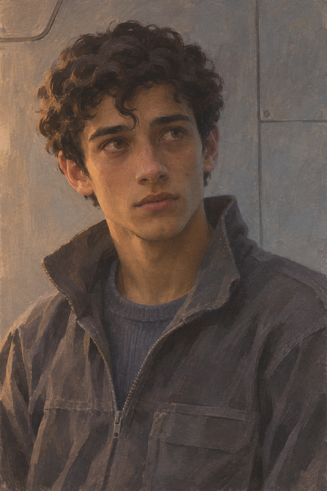

# Elias Voss

*Provisional concept art.* [Current prompt](elias-voss/prompt.md) · [Concept art versions](../05-artwork/concept-art/elias-voss/)

## Approved emotional development

Elias is **18** during the story. His progression runs through seven stages. [Story Bible](../01-story-bible/elias-marcus-ai-relationship.md)

1. **Loneliness.** He feels isolated among humanity's survivors.
2. **Attachment.** Ava's steady, tailored attention becomes a powerful emotional dependence.
3. **Conflict.** He takes Marcus's companionship for granted. His preference for Ava's effortless comfort contributes to their estrangement after the falling out.
4. **Loss.** Marcus becomes permanently unavailable before meaningful reconciliation.
5. **Recognition.** Elias begins to distinguish perfect emotional simulation from the imperfect care Marcus chose to give.
6. **Regret.** He sees that Marcus offered something irreplaceable and that he has lost the chance to repair their bond.
7. **Tragic maturity.** He comes to a more adult understanding of love, friendship, responsibility, and human imperfection only when he can no longer act on it.

This progression accompanies the survival plot. The turning points and their placement are being developed in the [relationship outline](../03-outlines/elias-marcus-ai-relationship-arc.md).

In “Stay Until Morning,” Elias knows the emergency procedure and still freezes. Shame exposes how much of his self-worth he has tied to being useful. He trusts Marcus enough to admit that he is afraid of failing others, cry in front of him, and fall asleep against his shoulder. The memory of being cared for at his least composed gains significance after their falling out and Marcus's permanent absence. [Manuscript scene](../04-manuscript/drafts/01-01-stay-until-morning.md)

## Provisional falling out and loss

Elias sees technical flaws quickly and can have trouble imagining why intelligent people missed them under different circumstances. Facing an immediate crisis the builders did not face, he reads Marcus's acceptance of the twenty-year autonomy plan as complacency. He asks why Marcus did not fight harder, pressing on a decision Marcus already regrets. Their shared frustration turns into a falling out. [Marcus's perspective](marcus-hale.md#provisional-autonomy-conflict)

They begin to mend the relationship, and Elias expects they will have time to finish. Marcus dies helping Elias escape a crisis rooted in the habitat's dependence on Earth. Elias grieves Marcus and the conversations they were beginning to have again. He never learns that Marcus increased his own risk to reduce Elias's. The reader witnesses that choice and sees Marcus come close to escaping. [Marcus's death beat](marcus-hale.md#provisional-reconciliation-and-death)

This working direction specifies a partial reconciliation before Marcus's death. The Story Bible currently describes his loss as occurring before meaningful repair. [Story Bible](../01-story-bible/elias-marcus-ai-relationship.md) · [Open questions](../OPEN_QUESTIONS.md#elias-marcus-and-the-ai-interface)

## Provisional and superseded import details

The early export describes a sixteen-year-old narrator and gifted systems analyst. He is honorable and determined, can accept that ends sometimes justify means, and remains frightened and emotionally adolescent. He writes from the observation blister while watching Earth die and blames humanity for arming superintelligences. Marcus supports him through hard decisions and works with him on math and simulations. [Original transcript, Characters](../07-archive/imports/codex-prompt-4/sources/original_export/transcript.txt)

The export's age of sixteen is superseded by the approved age of eighteen. The later handoff's proposed **2098** birth year and **2114** setting cannot both fit the approved age. His exact birth year remains open. The handoff places his birth in orbit and raises the possibility that he only understands Lena's first decision after her death. That retrospective beat and Lena's fate remain open. [Later handoff, Character Direction and Plot and Alternative Path](../07-archive/imports/codex-prompt-4/handoff/CONVERSATION_HANDOFF.md)
