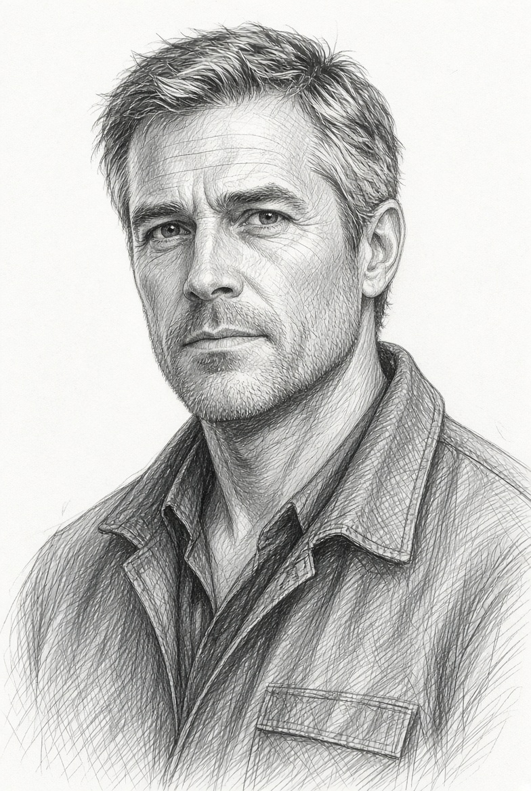

# Marcus Hale

*Provisional reference · tentative identification.*

## Approved relationship and character direction

Marcus is a human mentor who genuinely cares about Elias. He remembers prewar Earth, which gives him a different perspective on human relationships, autonomy, and dependence on AI. He can be tired, mistaken, frustrated, or unavailable. He can disagree with Elias and still choose to stand beside him. [Story Bible](../01-story-bible/elias-marcus-ai-relationship.md)

“Stay Until Morning” shows Marcus as a father figure through ordinary choices. He sits on the maintenance floor, admits his own fear and mistakes, offers a hand on Elias's neck, and stays through the night cycle despite an early shift. The first draft uses small gestures and tired, sometimes awkward conversation to show that Marcus loves Elias and has limits of his own. [Manuscript scene](../04-manuscript/drafts/01-01-stay-until-morning.md)

## Provisional character development

Marcus is social, well educated, and drawn to genuine human connection. Off duty he plays cards with the crew, spends time in the lounge, tells younger people about Earth, and talks philosophy with his peers. He remembers life before AI was part of every day, when people devised ingenious or sometimes silly ways to solve problems a quantum AI could now dispatch almost instantly. He remembers art made by people and what they once hoped technology would make possible. He has also seen what became of those hopes.

Marcus has an analytical, abstract mind and the intellectual ability for doctoral-level work. Elias and Lena have greater raw analytical ability. Marcus keeps up through experience. He was there when the habitat's systems were built and knows how they work, why they were built that way, and where the builders made compromises. He understands his own limits. He argued in practical terms when he spotted a bad design, and he could accept a decision once he understood why it made sense at the time. With hindsight, he can explain what went wrong and admit what he missed.

## Provisional autonomy conflict

Marcus argued for reducing the habitat's dependence on Earth. Immediate autonomy was beyond reach. He accepted a twenty-year transition shaped by decisions and bureaucracy outside his control. The war disrupted the path to full autonomy. His deepest professional regret is accepting twenty years when he believes they could have done it in five. Where the plan sits relative to the war and the habitat's assembly remains open. [Historical timeline](../01-story-bible/historical-timeline.md) · [Open questions](../OPEN_QUESTIONS.md#elias-marcus-and-the-ai-interface)

Marcus is usually slow to anger. Under pressure from the current crisis, Elias sees that old choice as complacency and presses Marcus on why he did not fight harder. Marcus understands the frustration because he shares it. Elias hits a regret Marcus has carried for years, and Marcus finally snaps. The autonomy dispute drives their falling out.

## Provisional reconciliation and death

They begin to repair their relationship and have reason to expect they will finish the conversation. A crisis rooted in the habitat's dependence on Earth cuts the repair short. Marcus knowingly takes on more risk to give Elias a safer way out. He expects to escape too, comes close, and dies. The reader sees his choice and has reason to believe he will get clear until the last moment. Elias knows Marcus died and never learns Marcus took on that extra risk to save him. [Elias's perspective](elias-voss.md#provisional-falling-out-and-loss)

A failing Earth-dependent cooling unit and a placement just after the Pattern are possible ways to tie his death to the technical plot. The equipment, timing, partial reconciliation scene, and how the reader sees Marcus's decision remain open. [Open questions](../OPEN_QUESTIONS.md#elias-marcus-and-the-ai-interface)

## Provisional import details

The early export describes an exceptionally capable mentor in his late forties. He works with Elias on math and simulations, supports him emotionally after difficult decisions, and would sacrifice his own life for Elias to have one. [Original transcript, Characters and Story Web / Beats](../07-archive/imports/codex-prompt-4/sources/original_export/transcript.txt)

The later handoff proposes **2066** as his birth year contingent on the **2114** setting. [Later handoff, Character Direction](../07-archive/imports/codex-prompt-4/handoff/CONVERSATION_HANDOFF.md)
